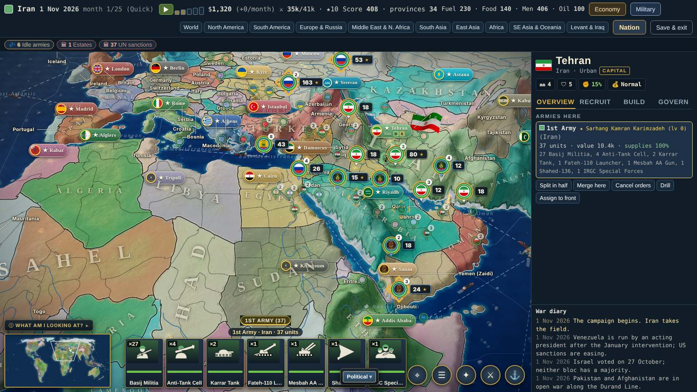
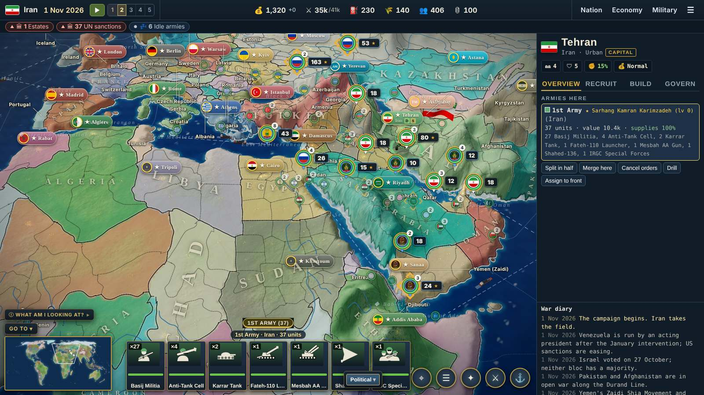

# camphud — one campaign top bar + a Nation window in six groups

Why: Abdullah, Wed 2026-11-11 19:25 Chicago, photo of the grand campaign screen: "The top tool bar is not intuitive" /
"Or better it's ugly"; 19:28, photo of the Nation window with about 36 tabs: "Ugly"; ORCH's layout: "Go" (19:28).
Reference for ideas only: Europa Universalis IV (no art, icons, text or exact layout copied). View only: no simulation,
save or sync change. Branch `orch/camphud`. Pictures: `node orch/camphudshots.mjs before|after`.

## Before → after (1600x900, an army selected)

| Before | After |
|---|---|
|  |  |

Other sizes: [before 1280](before-map-1280.jpg) · [after 1280](after-map-1280.jpg) · [before 1920, shown at 1600](before-map-1920.jpg) ·
[after 1920, shown at 1600](after-map-1920.jpg) · [after, 1280 at 130% text size with the menu open](after-text130-1280.jpg) ·
[a few months later: change arrows on the chips](after-map-later-1600.jpg)

Bar only: [1280](after-bar-1280.jpg) · [1600](after-bar-1600.jpg) · [1920](after-bar-1920.jpg) (before:
[1280](before-bar-1280.jpg) · [1600](before-bar-1600.jpg) · [1920](before-bar-1920.jpg))

Small menus: ["Go to" open](after-goto-open.jpg) · ["+1 more" open](after-alerts-more.jpg) · [☰ menu open](after-menu-open.jpg)

Nation window: [before, ~36 tabs](before-nation.jpg) → [Overview](after-nation-over.jpg) ·
[Government](after-nation-gov.jpg) · [Economy](after-nation-eco.jpg) · [Military](after-nation-mil.jpg) ·
[Diplomacy](after-nation-dip.jpg) · [World](after-nation-world.jpg)

## The top bar (one row, three zones)

| Zone | What is there | Click |
|---|---|---|
| Left: time | flag, nation name, date (hover: month N of M), play/pause, speed 1–5 as numbered steps | Space / 1–5 / + − as before |
| Center: resources | 💰 cash with monthly change (▲ green / ▼ red, sign and arrow so it never rests on color) · ⚔ army strength / force limit · ⛽ fuel · 🌾 food · 👥 manpower · 🛢 oil price. Hover = what it is, why it moves, change since last month | cash, fuel, food → Economy · strength → Military · manpower → Nation › Military › Mobilization · oil → Nation › Economy › World market |
| Right: windows | Nation · Economy · Military (same text style), then ☰ = Save & exit, Settings, Help | |

- Score, provinces and stars (army tradition) left the bar → Nation › Overview › Summary. The month counter is the date's hover and is in Summary too.
- The ten region buttons → ONE "GO TO ▾" list on top of the minimap (World, the eight regions, Levant & Iraq). They had no hotkeys, so none were added.
- Alert chips under the bar: at most five, most urgent first — ▲ red = needs you now, ◆ amber = soon, ● gray = information; the rest behind "+N more ▾". Clicking a chip goes to the thing.
- Narrow window or bigger text: the bar never wraps, it tightens in three steps (smaller gaps → no nation name and no force limit → only the current speed number).
- Esc closes a small menu first, then goes one step back inside a window, then closes the top window.

## Nation window: where every old tab went (35 old tabs + the new Summary = 36 screens, each in exactly one group)

| Group | Screens in its left-hand list (old tab id) |
|---|---|
| **Overview** — who you are | Summary (`ov`, new: score, provinces, army tradition ★, stability, leader, campaign month, strength and stocks, war support, war goals) · Leader (`ldr`) · Missions (`mis`) · Provinces (`prov`) · Modifiers (`mods`) · Achievements (`ach`) |
| **Government** — politics, estates, laws, decisions | People in power (`gov`, was "Government") · Decisions & policies (`dec`) · Estates (`estates`) · Ideas (`idea`) · Stability & expansion (`stab`) · Home front (`home`) · Propaganda (`prop`) · Elections & refugees (`elect`) · Corruption (`cor`) · Autonomy (`au`) · Research & cabinet (`res`) |
| **Economy** — budget, trade, industry, resources | Budget (`eco`, was "Economy") · Finance (`fin`) · Trade (`trade`) · World market (`mkt`) · Development (`dev`) · Pipelines & grids (`pipe`) |
| **Military** — armies, supply, mobilization, arms, intelligence | Armies (`mil`, was "Military") · Supply lines (`sup`) · Mobilization (`mob`) · Arms trade (`arms`) · Intelligence (`cov`) · Nuclear (`nuke`) |
| **Diplomacy** — relations, alliances, coalitions, subjects, UN | Relations (`dip`, was "Diplomacy") · Alarm & coalitions (`coal`) · Subjects (`subj`) · UN Security Council (`un`) |
| **World** — ledger, great powers, graphs | Ledger (`led`) · Great powers (`gp`) · Graphs (`gr`) |

Nothing was deleted or copied. Every screen is two clicks away at most (group, then screen). The window opens where you
left it (also after closing the game), each group remembers its last screen, and a nation opened from the Ledger or
Great powers gets a "‹ Back to …" button (Esc does the same). Generals, fleets, air, doctrine and stockpiles stay in
the Military window on the bar; news and the encyclopedia are not Nation screens today, so World holds what exists.

## For the next helper

- A new Nation screen: `npTab(...)` as before AND add its id to one group in `NP_GROUPS` (src/13j-nationpanel.js). An id that is not listed shows up in World; the guard in orch/decisions.mjs fails until it has a home.
- A new resource on the bar: one `chip(...)` line in `guTop` (src/13c-grandui.js). A new alert: `alAdd` (13l-galerts.js); return `bad:1` for red, list the id in `AL_INFO` for gray.
- Seen but not touched (not this helper's files): at 1280 wide the army cards overlap the minimap and two round buttons (it did before, see before-map-1280.jpg).
