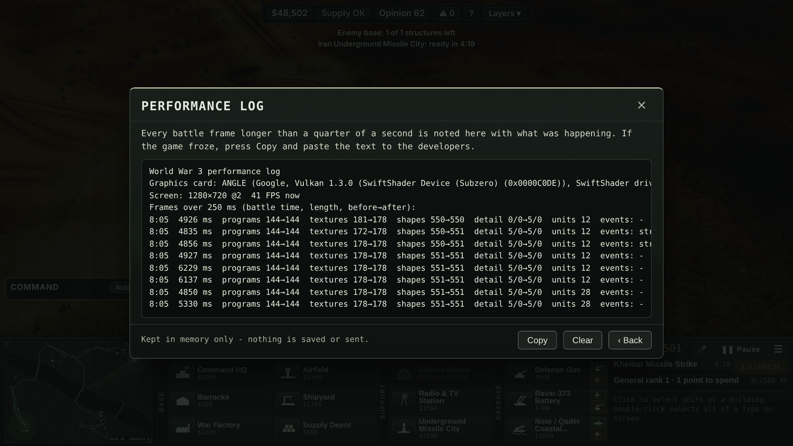

# freezefix — "The Kheibar missile strike is still freezing" (Abdullah, 2026-11-11 19:07)

## What was wrong

1. **The "BREAKING NEWS — MISSILE STRIKE" corner picture.** 1.2 s before the first missile lands, a small second view of
   the target is drawn in the corner. It was drawn straight to the screen, while the battle itself is always drawn into
   the post-processing picture. three.js needs a *different version of every shader* for those two cases, so the first
   corner picture compiled a second copy of every shader in view **in one frame** (24 programs in the small test scene,
   more in a real match). A software renderer does that in a blink; a real graphics card stops for it. The load-time
   warm-up never covered it, and the old test only timed JavaScript calls, so it could not see it.
2. **The 15-second graphics-memory clean-up** freed every shared shape that was not on screen at that moment (strike
   markers, missile bodies, exhaust cones, rock chunks, ping rings, banners), so the "prepared at load" shapes were sent
   to the graphics card again in exactly the frames of the launch and the impacts.
3. **Shapes built at the moment of the strike:** 9 new meshes per warning marker (108 in the launch frame of a
   12-missile strike), a new ring per shock ping (never freed), and a new 60-piece rubble heap (~275 KB) modeled and
   uploaded for every destroyed building.

## What changed (view only — simulation, sync hash and checkpoint untouched)

- The corner picture is drawn off-screen with the same shaders as the main view and copied to the corner; its buffer and
  copy shader are made while the battle loads (`src/08h-modern.js`, `mwPipWarm`).
- Strike markers, ping rings and rubble heaps use shapes built once and reused (scaled); all pooled strike shapes are
  drawn once at load and are exempt from the clean-up (`GC_KEEP` in `src/05-fx3d.js`, `src/05b-missiles.js`).
- `orch/superfreeze.mjs` (gate/superfreeze) now wraps the page's WebGL calls and fails when a strike compiles any shader,
  creates more than 2 textures or 6 meshes, reads pixels back, or has a frame more than 150 ms over the quiet stretch
  (frame-to-frame, CPU slowed 4×). Runs IR, RU, US with 36 enemy units standing on the target.
- **Settings → Graphics → Performance log…**: every battle frame over 250 ms is noted (battle time, length, shader
  programs / textures / shapes before → after, detail level, unit count, the last effect events, graphics card name);
  last 30, in memory only, with a Copy button (`src/08o-perflog.js`).

## One Kheibar strike (Iran, 12 missiles, 36 enemy units on the target), before and after

Test browser in the cloud sandbox, draw commands swallowed (software GL), CPU not slowed, launch → 5 s after the last hit.

| during the strike | before (main 1407bde) | after (orch/freezefix) |
|---|---|---|
| new shader programs compiled | **24** (48 shaders), 21 of them in one frame | **0** |
| new textures | 0 (+6 picture buffers when auto-detail stepped) | 0 |
| new meshes sent to the graphics card | **299** (505 buffers, 487 KB) | **0** |
| longest frame (normal frame 17–19 ms) | **236 ms** | 84 ms |

Russia (Iskander) and the US (Tomahawk) after: 0 programs, 0 textures, 0–1 meshes.

Not changed, and why: three sounds start decoding during a strike (battle loops) — browsers decode on another thread;
an automatic detail step (if the PC is struggling) rebuilds the picture buffers in one longer frame — it will show in the
Performance log as "detail 0/0→1/0".

## Picture

(The entries in the picture are real ones from the test machine, which draws in software at seconds per frame.)

## Still needs Abdullah's PC

No test machine here has his graphics card. Fire one Kheibar strike as Iran. If it still freezes:
Settings → Graphics → Performance log… → Copy → paste to ORCH.

## Gate on GitHub's runners

Run 1 (commit 172b31e): 25 of 27 green, including `superfreeze` (IR, RU, US, 4× CPU slowdown), `smooth-pc`, `smooth-mp`,
`grandsmooth`, `smoke4`, `decisions`. Red: `audio` (music crossfade timing check) and `migrate-down` (timed out waiting
for a client in the lobby) — neither touches code changed here and both are green on main; run 2 below re-checks them.
Run 2 (commit 4e92b69, same code, only this README changed): 25 of 27 green, `superfreeze` and `migrate-down` green.
Red: `audio` again, on a different check ("menu-02 did not start (slow or no connection)" — the soundtrack player's
start timeout), and `smooth-pc` (green in run 1 with the identical code). Across both runs every gate except `audio`
was green at least once; `audio` failed on two different music-timing checks that this branch does not touch.
Not landed — the conductor's own gate run decides.
